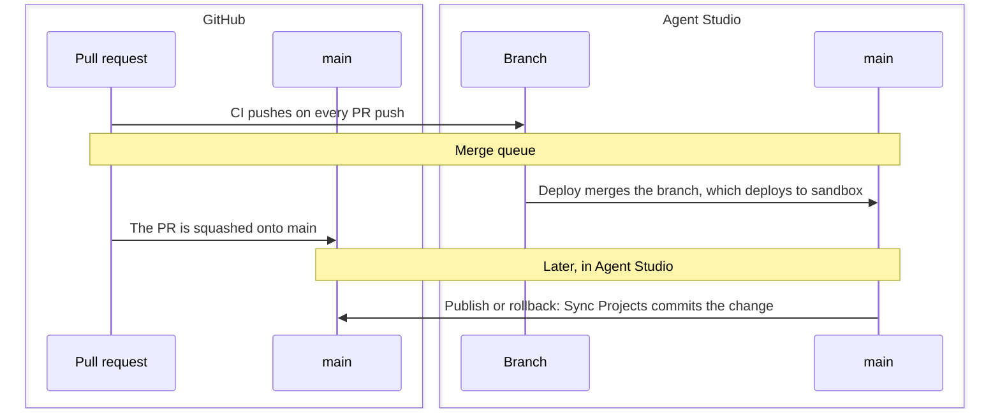

# Deploying from GitHub

The ADK repo template is a GitHub repository set up for ADK projects. Pull requests are linted, tested and pushed to an Agent Studio branch. Merging deploys them to Agent Studio. Changes published in Agent Studio come back into git.

[Use the template](https://github.com/new?template_name=adk-repo-template&template_owner=polyai){ target="_blank" rel="noopener" } · [Template repository](https://github.com/polyai/adk-repo-template){ target="_blank" rel="noopener" }

## How a change moves

Each git branch maps to an Agent Studio branch with the same name. The workflows keep the two in step.

| Step | In GitHub | In Agent Studio |
|---|---|---|
| 1. Branch | Create a git branch. | Point the ADK at the Agent Studio branch with the same name, creating it if needed. |
| 2. Pull request | CI lints, type-checks and tests the projects the PR changes. | CI pushes each changed project to its branch. |
| 3. Try it | | Test the branch with `poly chat` or in Agent Studio. |
| 4. Merge | The merge queue squashes the PR onto `main`. | Deploy merges each project's branch into `main`, which deploys to `sandbox`. |
| 5. Edits in Agent Studio | Sync Projects commits the change to `main`. | A publish or rollback tells the repo through a webhook. |

## What's in a repo

~~~
agents/
  <account>/
    <project>/            # One Agent Studio project, as pulled by the ADK
.github/
  workflows/              # CI, Deploy (merge queue), Sync Projects, branch cleanup
  scripts/                # Shared scripts the workflows and git hooks use
pyproject.toml            # Pins the polyai-adk version the workflows use
.pre-commit-config.yaml   # Git hooks that format projects the way a sync does
~~~

## Working on a project

Set up once per machine, from the repo:

~~~bash
uv venv && source .venv/bin/activate
uv pip install -e ".[dev]"
pre-commit install
poly setup
~~~

Then, for each change:

1. Create a git branch. From the project directory, switch the ADK to the Agent Studio branch with the same name. This creates the branch from `main` if it doesn't exist yet, and keeps your files:

    ~~~bash
    poly branch switch "$(git branch --show-current)" --create --from main --keep-files
    ~~~

    The ADK tracks its Agent Studio branch separately from git, so run this again after every `git switch`. See [branches](../development/branches-push-pull.md#branches).

2. Make your changes and commit them. The git hooks format each project the way a sync from Agent Studio would, so CI and the merge queue accept it. If a hook reformats files, add them and commit again.
3. Open a pull request. CI runs lint and tests, then pushes your changes to the Agent Studio branch.
4. Merge through the merge queue.

## Keeping Agent Studio and git in step

**Before a merge**, Deploy checks that Agent Studio's `main` matches git's `main` for each project. If Agent Studio has changes the repo doesn't, the PR fails with `AS branch main is not in sync with git main`: run Sync Projects for that project, then add the PR to the queue again. To merge anyway and overwrite the Agent Studio changes, add the `skip-as-sync-check` label to the PR first.

**After a change in Agent Studio**, the Sync Projects workflow pulls it into the repo and pushes it to `main`. It runs:

- when a project's [webhook](../reference/resources/experimental_config.md#webhooks) reports a publish or rollback;
- nightly;
- when the `polyai-adk` version in `pyproject.toml` changes, to re-sync every project;
- manually, from the repo's Actions tab.

## Setting up a repo

The template's [SETUP.md](https://github.com/polyai/adk-repo-template/blob/main/SETUP.md){ target="_blank" rel="noopener" } covers each step. In outline:

1. Create a repo from the template.
2. Create a GitHub App, which Sync Projects uses to push to `main`.
3. Add your ADK API keys as repo secrets.
4. Protect `main` with a ruleset that requires the CI check and the merge queue.
5. Add a webhook to each project, so publishes and rollbacks start Sync Projects.

!!! note "Merge queue availability"

    GitHub offers merge queues on public repos, and on private repos only in organisations on GitHub Enterprise Cloud.

## Keeping a repo up to date

- **The ADK version:** change the `polyai-adk` pin in `pyproject.toml` and merge it. Sync Projects then re-syncs every project with the new version. Check the [release notes](https://github.com/polyai/adk/releases){ target="_blank" rel="noopener" } first.
- **The workflows:** pull changes from the template with `.github/scripts/sync-from-template.sh`, which previews by default; add `--apply` to commit them.

## Next steps

-   **Branches, push, and pull**

    ---

    How Agent Studio branches work with the ADK.
    [Open branches, push, and pull](../development/branches-push-pull.md)

-   **Environments and deployment**

    ---

    Promote merged changes from sandbox to pre-release and live.
    [Open environments and deployment](../development/environments-and-deployment.md)

-   **Webhooks**

    ---

    Send deployment events from Agent Studio to your repo.
    [Open the webhooks reference](../reference/resources/experimental_config.md#webhooks)

